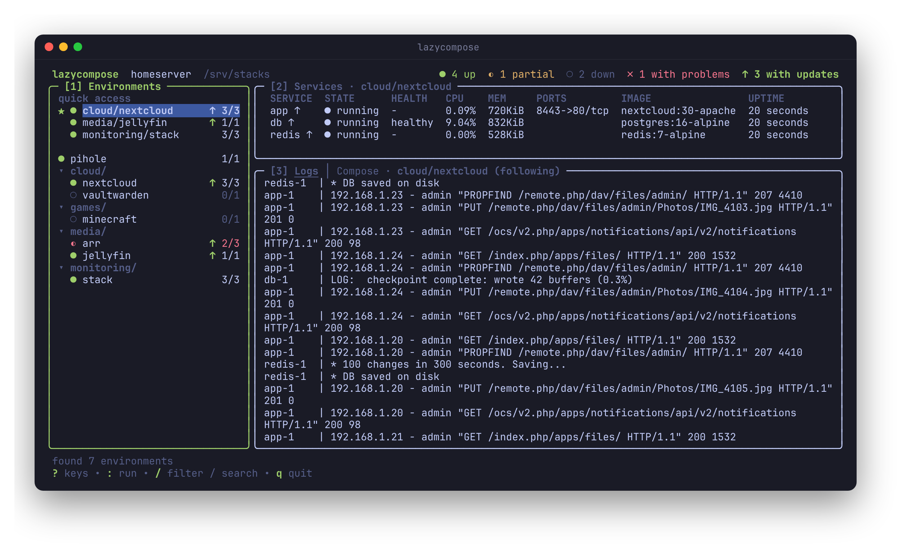

# lazycompose

A terminal UI for managing Docker Compose stacks on a home server. It scans
your app folders for compose files, shows what is running, and lets you start,
stop, restart, pull, edit and tail logs without leaving the terminal.

_Screenshot coming soon._
<!--  -->

## How it works

Every folder with a `compose.yaml` (or `compose.yml`, `docker-compose.yaml`,
`docker-compose.yml`) under one of the configured roots is an environment:

```
/mnt/data/global
├── game-servers/minecraft/compose.yaml
├── plex/compose.yaml
└── web/blogger/compose.yaml
```

Environments are grouped by their parent folder. The status dot shows
`●` all services running, `◐` some running, `○` down.

lazycompose runs on the host, not in a container, since it calls
`docker compose` and opens your editor.

## Build

Everything builds inside Docker, so Go does not need to be installed.

Using the dev service:

```sh
docker compose run --rm dev go build -trimpath -ldflags="-s -w" -o bin/lazycompose ./cmd/lazycompose
```

Or using the multi-stage image:

```sh
docker build --target bin -t lazycompose-bin .
id=$(docker create lazycompose-bin /lazycompose)
docker cp $id:/lazycompose bin/lazycompose
docker rm $id
```

With BuildKit you can skip the container step:
`docker build --target bin --output bin .`

The result is a static binary. Install it somewhere on your `PATH`:

```sh
sudo install -m 755 bin/lazycompose /usr/local/bin/lazycompose
```

Run the tests:

```sh
docker compose run --rm dev go test ./...
```

## Config

`~/.config/lazycompose/config.yaml`:

```yaml
roots:
  - /mnt/data/global
max_depth: 3
```

Both values are optional; the defaults are shown above. Flags:

| Flag | Description |
| --- | --- |
| `-root DIR` | Folder to scan. Repeat or comma separate for several. Overrides `roots`. |
| `-max-depth N` | How many folders deep to look. Overrides `max_depth`. |
| `-config FILE` | Use a different config file. |

## Keys

| Key | Action |
| --- | --- |
| `tab` / `shift+tab` | Switch pane (environments, services, logs) |
| `j` `k` / arrows | Move, or scroll the log pane |
| `/` | Filter environments, `enter` to keep, `esc` to clear |
| `e` | Edit the compose file in `$EDITOR` (falls back to nvim, then vi) |
| `u` | `docker compose up -d` |
| `d` | `docker compose down` (asks first) |
| `r` | `docker compose restart` |
| `p` | `docker compose pull` |
| `l` | Follow logs |
| `x` | Open a shell in the selected service (`exec <svc> sh`) |
| `esc` | Stop following logs |
| `R` | Refresh and rescan folders |
| `?` | Show all keys |
| `q` | Quit |

`u`, `r`, `p` and `l` act on the whole environment, or on the selected
service when the services pane is focused.

After editing, lazycompose runs `docker compose config -q`. If the file is
valid it asks whether to apply the changes with `up -d`; if not, the error is
shown in the log pane.

Status refreshes every 3 seconds.
